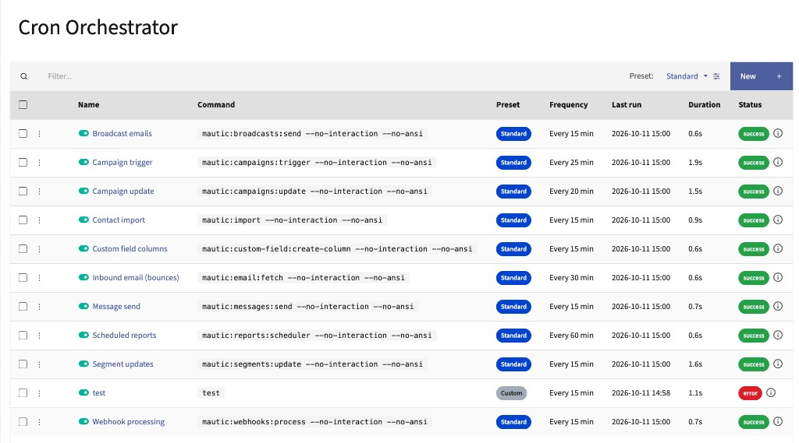
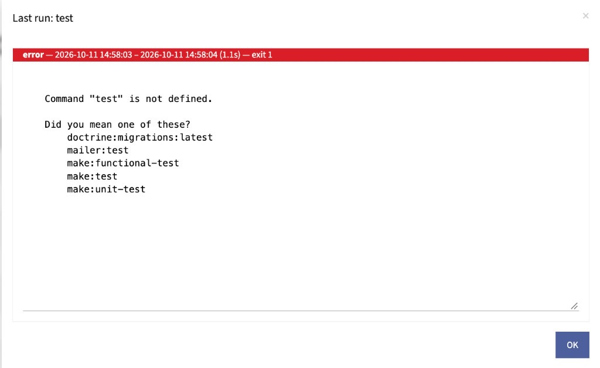

# Mautic Cron Orchestrator

A plugin for Mautic that replaces dozens of system cron entries with a **single** orchestrator command. Jobs (segments, campaigns, broadcasts, webhooks, …) are configured in the Mautic UI and run on a schedule stored in the database.





## What This Plugin Does

- runs due maintenance jobs via `mautic:cron:run` (one system cron every minute)
- ships presets (**Minimal** / **Standard** / **Full**) plus an empty **Custom** mode; switching presets never deletes your custom jobs
- admin list with search, name sorting, preset badges, and campaign-style on/off toggles
- batch enable / disable / delete for selected jobs
- manual **Run now** starts the job in the background so the UI returns immediately
- last-run status with an info dialog showing command output; recent run history on the job edit page
- log retention cleanup via plugin settings / `mautic:cron:run --cleanup-only`

## Requirements

| Mautic | PHP | Package |
|--------|-----|---------|
| Mautic 5 | PHP 8.0+ | `mauticinsights/mautic-cron-orchestrator:^5` |
| Mautic 6 | PHP 8.1+ | `mauticinsights/mautic-cron-orchestrator:^6` |
| Mautic 7 | PHP 8.2+ | `mauticinsights/mautic-cron-orchestrator:^7` |

- Composer 2.x

## Installation

### Recommended (Packagist)

From the root of your Mautic project. Use a constraint that matches your Mautic major version.

#### Mautic 7

```bash
composer require mauticinsights/mautic-cron-orchestrator:^7
```

#### Mautic 6

```bash
composer require mauticinsights/mautic-cron-orchestrator:^6
```

#### Mautic 5

```bash
composer require mauticinsights/mautic-cron-orchestrator:^5
```

Package: [packagist.org/packages/mauticinsights/mautic-cron-orchestrator](https://packagist.org/packages/mauticinsights/mautic-cron-orchestrator)

### Alternative: install from ZIP (no Composer)

1. Download **Source code (zip)** for the release that matches your Mautic major version (plugin `5.x` → Mautic 5.x, `6.x` → Mautic 6.x, `7.x` → Mautic 7.x, …): [github.com/mauticinsights/mautic-cron-orchestrator/releases](https://github.com/mauticinsights/mautic-cron-orchestrator/releases).
2. Extract the ZIP into your Mautic plugins directory as **`plugins/MauticCronOrchestratorBundle`** (on Composer-based installs often `docroot/plugins/MauticCronOrchestratorBundle`).

   The plugin root must contain `composer.json` at:

   `plugins/MauticCronOrchestratorBundle/composer.json`

   GitHub ZIPs usually unpack to a folder like `mautic-cron-orchestrator-6.0.0` — rename that folder to `MauticCronOrchestratorBundle` (or extract so the contents land directly in `plugins/MauticCronOrchestratorBundle/`).
3. Click **Install/Upgrade Plugins** in **Settings → Plugins** instead.

### Alternative: install from GitHub (VCS)

Only needed if you want a branch / unreleased commit. Add to the `repositories` section of Mautic’s `composer.json`:

```json
{
  "type": "vcs",
  "url": "https://github.com/mauticinsights/mautic-cron-orchestrator"
}
```

Then:

```bash
# Mautic 7
composer require mauticinsights/mautic-cron-orchestrator:dev-7.x -W

# Mautic 6
composer require mauticinsights/mautic-cron-orchestrator:dev-6.x -W

# Mautic 5
composer require mauticinsights/mautic-cron-orchestrator:dev-5.x -W
```

### After install

If you have CLI access:

```bash
php bin/console cache:clear --env=prod
php bin/console mautic:plugins:reload
```

Then in the Mautic UI:

1. Open **Settings** (gear icon) → **Plugins** (after a ZIP install, click **Install/Upgrade Plugins** if the plugin is not listed yet).
2. Open **Mautic Cron Orchestrator** / **Cron Orchestrator**.
3. Set **Enabled** to **Yes** and save.
4. **Refresh the page** (full browser reload) so the **Cron Jobs** menu appears.
5. Open **Settings** (gear icon) → **Cron Jobs** (admin users only; URL `/s/cron`).

When the plugin is disabled, the Cron Jobs UI is hidden and `mautic:cron:run` does nothing.

### System cron

Remove the individual Mautic cron lines (`mautic:segments:update`, `mautic:campaigns:trigger`, …) so jobs do not run twice.

**User crontab** (`crontab -e` as the web user, e.g. `www-data`) — 5 time fields, then the command:

```
* * * * * /usr/bin/php /path/to/mautic/bin/console mautic:cron:run
```

**System crontab** (`/etc/crontab` or `/etc/cron.d/…`) — 5 time fields, then **username**, then the command:

```
* * * * * www-data /usr/bin/php /path/to/mautic/bin/console mautic:cron:run
```

Use the absolute path to `php` (`which php`). On Debian/Ubuntu the web user is usually `www-data`.

Useful options:

```bash
php bin/console mautic:cron:run --dry-run
php bin/console mautic:cron:run --cleanup-only
```

## Usage

On first install the plugin seeds the **Standard** preset automatically. After that, manage jobs under **Settings → Cron Jobs**:

1. Apply a preset (**Minimal** / **Standard** / **Full**) or click **Add custom job**.
2. For each job you can enable/disable, edit frequency, run immediately, or delete.
3. Open a job to see recent run logs, or use the info icon next to Status for the last run output.

**Applying a preset** (including **Custom**) replaces only jobs from built-in presets (`minimal` / `standard` / `full`). Custom jobs you added yourself are always left untouched.

Presets follow the official [Mautic cron jobs](https://docs.mautic.org/en/5.2/configuration/cron_jobs.html) guide:

| Preset | Jobs | Typical use |
|---|---|---|
| **Minimal** | Required: segments, campaign update/trigger, messages, custom-field columns | Small installs |
| **Standard** | Minimal + broadcasts, webhooks, import, bounce fetch, reports | Most production sites |
| **Full** | Standard + GeoIP, maintenance cleanup, MaxMind CCPA, unused IPs, social, contact export | Full feature set / compliance |

Core segment/campaign frequencies are staggered (15 / 20 / 25 min). Every preset job includes `--no-interaction --no-ansi`.

## Development

```bash
composer install
make ci          # cs-check + phpstan + phpunit
make all         # cs-fixer + phpstan + test
```

## License

This project is licensed under the [MIT License](./LICENSE).
